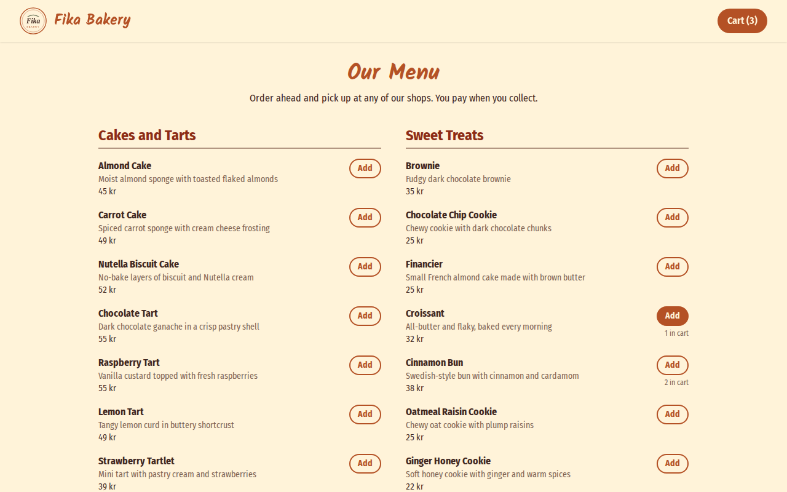
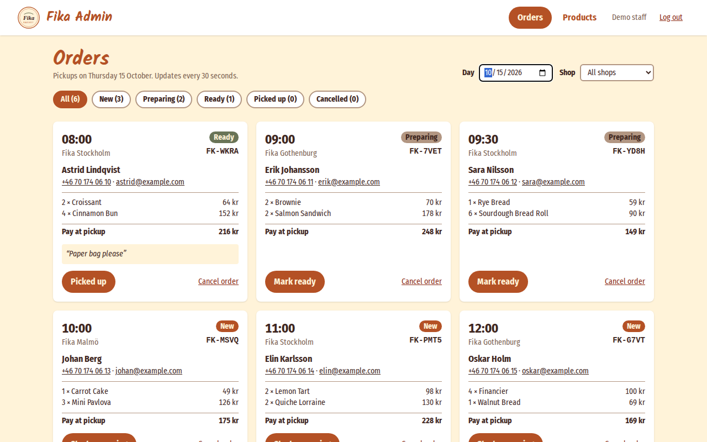
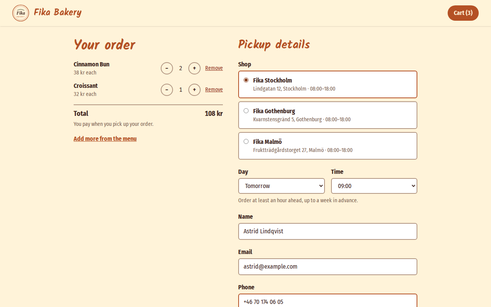
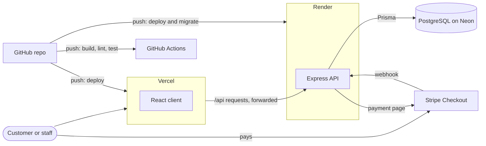

# Fika Bakery

Fika is a fictional Swedish bakery with shops in Stockholm, Gothenburg and Malmö. This repo has two parts:

- **An ordering app** (full stack): customers order cakes, bread and sandwiches for pickup, and staff follow the orders in an admin panel. React and TypeScript on the front end, Express, Prisma and PostgreSQL on the back end, with automated tests and API documentation.
- **The original static website**, hand-written in HTML and CSS.

| | |
| --- | --- |
| **Ordering app** | [bageti.vercel.app](https://bageti.vercel.app) |
| **Admin panel** | [bageti.vercel.app/admin](https://bageti.vercel.app/admin), demo login below |
| **API documentation** | [bageti.vercel.app/api/docs](https://bageti.vercel.app/api/docs/) |
| **Static site** | [nataliyabenova-walsh.github.io/bageti](https://nataliyabenova-walsh.github.io/bageti/) |

The app runs on free hosting: if nobody has used it for 15 minutes, the first page can take up to a minute to load while the server wakes up.



## History

This started as a school project: a static website in HTML and CSS for a real local bakery. The business was later sold, so I turned the site into Fika, a fictional bakery, replaced the real names, photos and contact details, and built it out into a full-stack ordering system with an admin panel, tests and API documentation.

## Try the admin panel

| Email | Password | Role |
| --- | --- | --- |
| `demo@example.com` | `fika-demo` | Staff |

The demo login has the **staff** role: it can see all orders, move them through their steps and mark products sold out, but it can't add products or change names and prices. Place an order in the shop first, then find it on the order board.



## Features

**Customers**

- Browse the menu by category, with prices in SEK and sold-out items marked
- A cart kept in the browser, so it survives a reload
- Checkout: choose a shop, a day and a 15-minute pickup slot, and enter contact details. Errors are shown next to each field.
- Pay now by card on Stripe's payment page (test mode: use the card `4242 4242 4242 4242`), or pay at pickup
- A confirmation with an order code like `FK-7Q2M` to show at the counter



**Staff and admins**

- **Order board:** one day's pickups, filtered by shop and status, refreshed every 30 seconds. Orders move New → Preparing → Ready → Picked up, one step at a time, and can be cancelled until they're picked up.
- **Products:** mark products sold out or back in stock. Admins can also add products and change their name, description, price and category.

**Rules the server enforces**

- Pickup times are every 15 minutes during opening hours (08:00–18:00 Swedish time), at least 1 hour and at most 7 days ahead. Times are worked out in the Europe/Stockholm time zone, including the days the clocks change (`server/src/pickup.ts`).
- The server prices each order from the database and ignores prices sent by the browser. Name and price are copied into the order, so later menu changes don't alter past orders.
- Orders with sold-out products are refused, and the checkout removes those products from the cart.
- Logins use scrypt password hashes and a signed JWT in an httpOnly cookie. Wrong emails and wrong passwords get the same answer.
- Card orders only reach the order board once Stripe confirms the payment, through a signed webhook. If the customer doesn't pay within 35 minutes, the payment page expires and the order is cancelled. Repeated or late webhooks change nothing.
- Orders and logins are rate-limited per visitor.

## Architecture



The browser only talks to `bageti.vercel.app`. Vercel serves the React app and forwards every `/api` request to the Express server on Render, so the login cookie belongs to the same site and works in every browser, including Safari. Render runs database migrations on each deploy.

## Built with

| Part | Tools |
| --- | --- |
| Client (`client/`) | React 19, TypeScript, Vite, Tailwind CSS, React Router, Zustand (cart), React Hook Form and Zod (checkout) |
| API (`server/`) | Node 22, Express 5, TypeScript, Prisma 7, PostgreSQL, Zod (validation), jose (JWT), Stripe (card payments) |
| Tests | Vitest and Supertest (API), Playwright (end to end) |
| Docs | OpenAPI 3.1 (`server/openapi.yaml`), served with Swagger UI |
| Hosting | Vercel (client), Render (API), Neon (database), GitHub Actions (CI) |

## Run it locally

You need Node.js 22 or later. Development uses local PostgreSQL databases that Prisma runs without Docker, so nothing touches the live data.

```bash
npm install
cp server/.env.example server/.env   # then set JWT_SECRET and ADMIN_PASSWORD
npm run db:local -w server          # start the development database (again after each restart)
npm run db:migrate -w server        # create the tables and the three shops
npm run db:seed -w server           # load the menu from data/menu.json
npm run dev                          # client on :5173, API on :3001
```

- **Shop:** http://localhost:5173
- **Admin:** http://localhost:5173/admin, with `ADMIN_EMAIL` and `ADMIN_PASSWORD` from `server/.env`, or the demo login
- **API docs:** http://localhost:5173/api/docs/

**Card payments** are optional. To try them locally, add a Stripe test key (`sk_test_…`) as `STRIPE_SECRET_KEY` in `server/.env`, and forward webhooks with the [Stripe CLI](https://docs.stripe.com/stripe-cli): `stripe listen --forward-to localhost:3001/api/stripe/webhook` prints the `STRIPE_WEBHOOK_SECRET` to add. Without a key, the checkout only offers paying at pickup.

Port 3001 is the API only, so opening it in the browser shows "Cannot GET /". Stop `npm run dev` before `db:migrate` or `db:seed`, because the local database accepts only one connection at a time. The seed is safe to run again: it updates products instead of adding duplicates.

## Tests

```bash
npm run db:test -w server   # start the test database once, and put its URL in TEST_DATABASE_URL in server/.env
npm test                    # API tests, then the end-to-end test
```

- **API tests** (`server/src/*.test.ts`, Vitest and Supertest): the menu, pickup times across clock changes, placing orders (pricing, validation, sold-out items), card payments (Stripe calls replaced, webhooks signed with a test secret), login, and what staff and admins may do. They empty and refill the test database first, and refuse to run against anything but a local database.
- **Documentation test:** checks that every route in the code is in `openapi.yaml`, and that every documented route exists.
- **End-to-end test** (`e2e/`, Playwright): a customer orders in a real browser, then a staff member logs in, finds the order and starts preparing it. It runs its own API and client on ports 3101 and 5174, so it doesn't disturb `npm run dev`.

GitHub Actions runs the build, lint, API tests and end-to-end test on every push, with a throwaway PostgreSQL database.

## API

The full reference is at [/api/docs](https://bageti.vercel.app/api/docs/), where you can also try the requests. It's generated from [`server/openapi.yaml`](server/openapi.yaml).

- Prices are in öre, hundredths of a krona (`"priceCents": 4500` is 45 kr).
- Times are UTC ISO strings, such as `"2026-10-15T06:45:00.000Z"` for 08:45 in Sweden.
- Admin routes need the session cookie from `POST /api/auth/login`.

Example order:

```bash
curl -X POST https://bageti.vercel.app/api/orders \
  -H 'Content-Type: application/json' \
  -d '{
    "customerName": "Astrid Lindqvist",
    "email": "astrid@example.com",
    "phone": "+46 70 174 06 05",
    "locationId": "riverside",
    "pickupAt": "<a time from /api/locations/riverside/pickup-slots>",
    "items": [{ "productId": 13, "quantity": 2 }]
  }'
```

## Deployment

| Part | Host | Settings |
| --- | --- | --- |
| API | [Render](https://render.com), free plan | `render.yaml` Blueprint. Set `DATABASE_URL` (Neon), `ADMIN_EMAIL` and `ADMIN_PASSWORD`. Render generates `JWT_SECRET`, and the demo login comes from `render.yaml`. Migrations run on each deploy. For card payments, also set `STRIPE_SECRET_KEY`, `STRIPE_WEBHOOK_SECRET` and `CLIENT_URL`. |
| Client | [Vercel](https://vercel.com) | Root directory `client`. `client/vercel.json` forwards `/api` to Render and sends every other path to the app, so links like `/checkout` work. |
| Payments | [Stripe](https://stripe.com), test mode | Add a webhook endpoint (Developers → Webhooks) for `https://fika-api-eqig.onrender.com/api/stripe/webhook` with the events `checkout.session.completed`, `checkout.session.async_payment_succeeded`, `checkout.session.expired` and `checkout.session.async_payment_failed`. Its signing secret is `STRIPE_WEBHOOK_SECRET`. |
| Database | [Neon](https://neon.tech) | Seed the menu once with `DATABASE_URL=<production URL> npm run db:seed -w server` |

## Project structure

```
client/          React app: shop pages, checkout, admin panel
server/          Express API
  src/app.ts       Routes and middleware
  src/pickup.ts    Pickup time rules (Swedish time)
  src/auth.ts      Passwords, sessions and roles
  src/stripe.ts    Stripe Checkout sessions and payment updates
  src/routes/      Menu, shops, orders, payments, login and admin routes
  prisma/          Database schema, migrations and seed script
  openapi.yaml     API documentation
e2e/             Playwright end-to-end test
data/            Menu data (menu.json), used by the seed script
render.yaml      Render deployment settings
index.html, css/, images/   The static website
docs/            Screenshots
```

## The static website

The first version of Fika, from the original school project: hand-written in semantic HTML and CSS (Flexbox, Grid, no framework or build step), hosted on GitHub Pages. It has a hero banner, a photo grid, the menu, the shops and a contact section, and works down to phone width. Photos are from [Pexels](https://www.pexels.com).

[](https://nataliyabenova-walsh.github.io/bageti/)

To view it locally, open `index.html`, or run `npx serve .`.

*Fika is a demo project, not a real shop.*
