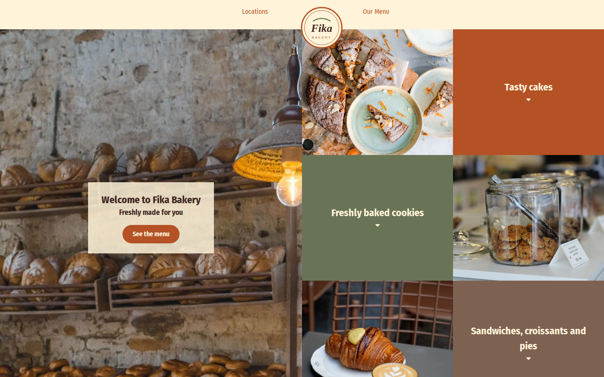

# Fika Bakery

A demo website for Fika, a fictional bakery and café. It's built with plain, hand-written HTML and CSS, with no frameworks or build step.

**[View the live site →](https://nataliyabenova-walsh.github.io/bageti/)**

[](https://nataliyabenova-walsh.github.io/bageti/)

## Sections

- **Hero:** full-height photo with a welcome banner and a link to the menu
- **Product tiles:** a photo and colour-block grid for cakes, cookies, sandwiches and pies, and breads
- **Menu:** products grouped by category, with descriptions and prices
- **Locations:** the bakery's shops
- **Contact:** email and phone

The layout is responsive: under 768px the tiles stack into two columns and the menu and locations go full-width.

## Built with

- **Semantic HTML5**
- **CSS Flexbox and Grid** for layout, plus a CSS reset
- **Google Fonts** (Fira Sans Condensed, Kalam)
- **Font Awesome** icons
- Hosted on **GitHub Pages**
- Photos from [Pexels](https://www.pexels.com), resized and converted to WebP

## Run locally

No build is needed. Open `index.html` in a browser, or serve the folder:

```bash
npx serve .
```

## Ordering app (in progress)

A full-stack ordering system is being built alongside the static site. **[View the ordering app →](https://bageti.vercel.app)** (the first visit can take up to a minute while the free server wakes up)

- **`client/`:** React, TypeScript, Vite and Tailwind CSS
- **`server/`:** Node, Express and TypeScript, with Prisma and PostgreSQL (hosted on [Neon](https://neon.tech))

Customers can browse the menu, fill a cart (kept in the browser), choose a shop and a pickup time, and place an order to pay at pickup.

To run it you need Node.js 22+. Development uses a local PostgreSQL database that Prisma runs without Docker, so test orders never reach the live site:

```bash
npm install
cp server/.env.example server/.env   # already set up for the local database
npm run db:local -w server          # start the local database (again after each restart)
npm run db:migrate -w server        # create the tables and the three shops
npm run db:seed -w server           # load the menu from data/menu.json
npm run dev                          # client on :5173, API on :3001
```

Open the app at http://localhost:5173. Port 3001 is the API only, so opening it directly in the browser shows "Cannot GET /". The seed can be run again at any time: it updates existing products instead of adding duplicates. Run the server's tests with `npm test -w server`.

### Ordering rules

- Pickup is every 15 minutes during opening hours (08:00–20:00 Sofia time), at least 1 hour ahead and up to 7 days ahead. The rules are in `server/src/pickup.ts`.
- The server prices every order from the database and ignores prices sent by the client.
- Products with `available: false` show as sold out, and orders containing them are refused.
- Each order gets a short code like `FK-7Q2M` for the counter. Orders are saved as "pay at pickup".
- One visitor can send at most 10 orders every 15 minutes.

### API

| Method | Path | Returns |
| --- | --- | --- |
| GET | `/api/health` | Server and database status |
| GET | `/api/categories` | The whole menu: categories in display order, each with its products |
| GET | `/api/products` | All products. Add `?category=breads` for one category |
| GET | `/api/products/:id` | One product, or 404 |
| GET | `/api/locations` | The shops, with opening hours |
| GET | `/api/locations/:id/pickup-slots` | Bookable pickup times for the next 7 days, grouped by date |
| POST | `/api/orders` | Places an order. Returns 201 with the order code, 400 for invalid details or pickup time, 409 if an item sold out |

Prices are whole cents in EUR (`priceCents: 450` is €4.50). Times are UTC ISO strings, such as `"2026-10-15T05:45:00.000Z"` for 08:45 in Sofia.

Example order body:

```json
{
  "customerName": "Maria Ivanova",
  "email": "maria@example.com",
  "phone": "+359 88 765 4321",
  "locationId": "riverside",
  "pickupAt": "2026-10-15T05:45:00.000Z",
  "items": [{ "productId": 1, "quantity": 2 }]
}
```

### Deployment

| Part | Host | Settings |
| --- | --- | --- |
| API (`server/`) | [Render](https://render.com), free plan | `render.yaml` Blueprint. Set `DATABASE_URL` (Neon) and `CLIENT_ORIGIN` (the Vercel address). Migrations run on each deploy. |
| Client (`client/`) | [Vercel](https://vercel.com) | Root directory `client`. Set `VITE_API_URL` to the Render address. `client/vercel.json` sends every path to the app, so links like `/checkout` work. |
| Database | [Neon](https://neon.tech) | Seed once with `DATABASE_URL=<production URL> npm run db:seed -w server` |

The free Render server sleeps after about 15 minutes without visitors, so the first visit after that can take up to a minute. The client shows "Waking up the server…" while it waits.

GitHub Actions (`.github/workflows/ci.yml`) builds both apps, lints the client and runs the server tests on every push and pull request.

## Structure

```
index.html     Page markup
css/           Reset and main stylesheet
data/          Menu data (menu.json), used to seed the ordering system's database
images/        Product and location photos
docs/          README screenshot
client/        React ordering app
server/        Express API and Prisma schema
render.yaml    Render deployment settings for the API
```
